  
  
  
  
  

  

  

  

Source code &amp; demos

 

| Project | Stack | Links |
| :--- | :--- | :--- |
| **All-in-One Platform** | `Next.js` `TypeScript` | [Repo](https://github.com/dokhaidev/all-in-one-platform) · [Demo](https://all-in-one-platform-xi.vercel.app) |
| **CellphoneS Clone** | `Next.js` `TypeScript` | [Repo](https://github.com/dokhaidev/cellphoneS-clone) · [Demo](https://cellphones-three.vercel.app) |
| **Product Management** | `Next.js` `TypeScript` | [Repo](https://github.com/dokhaidev/product-management) · [Demo](https://handee-rose.vercel.app) |
| **Quiz App** | `Next.js` `TypeScript` | [Repo](https://github.com/dokhaidev/quiz-app) · [Demo](https://quiz-app-lime-eta.vercel.app) |
| **Photography Portfolio** | `HTML` `CSS` | [Repo](https://github.com/dokhaidev/photography) · [Demo](https://photography-iota-ruby.vercel.app) |
| **Booking Sushi** | `PHP` | [Repo](https://github.com/dokhaidev/booking-sushi) |

 

  

 

 

 

